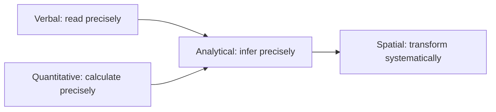

# General Aptitude

> **Paper:** CS+DA · **Weight:** 15 marks · **Priority:** P0

**PYQ weightage:** ~9.9 Qs per CSE paper (2021–26), trend steady; DA: 30 Qs in 2024–26.

General Aptitude is common to both papers and contributes 15 of 100 marks. Study it in short, frequent sessions: reading and grammar are skill based, while arithmetic and reasoning improve through timed practice.

| Order | Chapter | Focus | PYQ weightage |
|---|---|---|---|
| 1 | [Verbal aptitude](verbal-aptitude.md) | Grammar, vocabulary, reading, sequencing | High · 70 |
| 2 | [Quantitative aptitude](quantitative-aptitude.md) | Arithmetic, charts, elementary probability | High · 104 |
| 3 | [Analytical aptitude](analytical-aptitude.md) | Deduction, patterns, arrangements | High · 35 |
| 4 | [Spatial aptitude](spatial-aptitude.md) | Transformations and visual patterns | High · 19 |

## Study priority

- [Quantitative aptitude](quantitative-aptitude.md) (High · 104) — master probability and counting, data interpretation, ratios and percentages, and mensuration arithmetic first; most marks per paper.
- [Verbal aptitude](verbal-aptitude.md) (High · 70) — master passage reading and sentence completion (most appropriate word, word pairs) before vocabulary lists; skill improves only through timed practice.
- [Analytical aptitude](analytical-aptitude.md) (High · 35) — master logical deductions, syllogisms and direction sense; a fixed set of question types recurs every year.
- [Spatial aptitude](spatial-aptitude.md) (High · 19) — master paper folding/cutting, mirror and rotation patterns, and cube/face assembly; new in the 2021 syllabus and rising.

**Mental model:** Every question gives enough information. Identify what is being asked, represent the given facts, then eliminate choices that add assumptions.

Connections: [propositional logic](../01-discrete-mathematics/propositional-logic.md) formalises conditional language; [probability basics](../02-probability-statistics/probability-basics.md) extends elementary counting; [exam strategy](../EXAM-STRATEGY.md) helps allocate time.

[Cheatsheet](CHEATSHEET.md) · [Checkpoint](CHECKPOINT.md) · [Roadmap](../ROADMAP.md) · [Connections](../CONNECTIONS.md) · [Progress](../PROGRESS.md)
