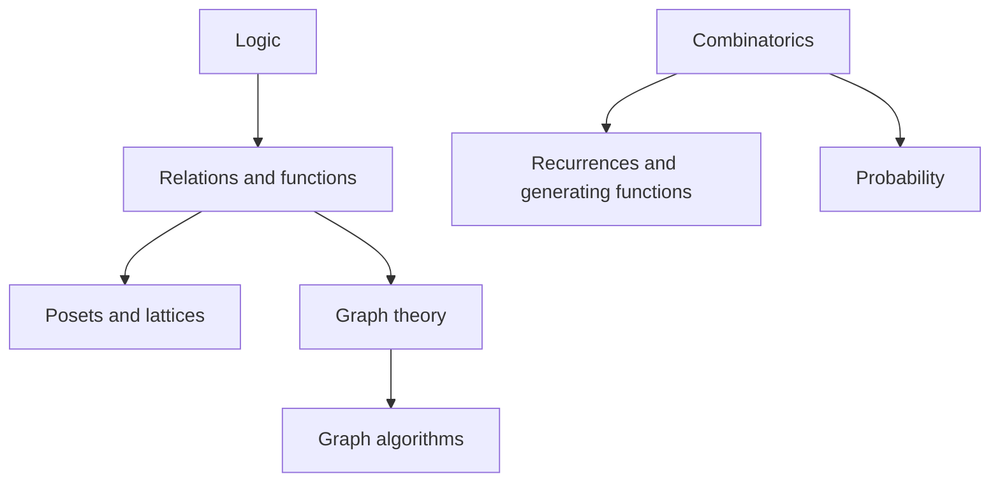

# Discrete Mathematics

> **Paper:** CS · **Priority:** P0/P1

**PYQ weightage:** ~4.9 Qs per CSE paper (2021–26), trend falling; DA: 2 Qs in 2024–26.

Discrete mathematics provides the language for algorithms, automata, databases, and logic. Start with logic and sets, then study orders and algebra, then counting and graphs; recurrences connect the counting ideas to algorithm analysis.

| Order | Chapter | Priority | Main use | PYQ weightage |
|---|---|---|---|---|
| 1 | [Propositional logic](propositional-logic.md) | P0 | Truth, implication, equivalence | High · 18 |
| 2 | [First-order logic](first-order-logic.md) | P1 | Predicates and quantifiers | Medium · 12 |
| 3 | [Sets, relations, functions](sets-relations-functions.md) | P0 | Relations, equivalence, mappings | High · 25 |
| 4 | [Posets and lattices](posets-and-lattices.md) | P1 | Partial orders and bounds | Low · 3 |
| 5 | [Algebraic structures](algebraic-structures.md) | P1 | Monoids and groups | Medium · 10 |
| 6 | [Combinatorics](combinatorics.md) | P0 | Count without omission or duplication | Medium · 12 |
| 7 | [Graph theory](graph-theory.md) | P0 | Connectivity, matching, colouring | High · 25 |
| 8 | [Recurrences and generating functions](recurrences-and-generating-functions.md) | P0 | Sequences and algorithm cost | Medium · 8 |

## Study priority

- [Graph theory](graph-theory.md) (High · 25) — master connectivity, colouring, degree sequences and planarity first; also the most-used source for algorithm questions.
- [Sets, relations, functions](sets-relations-functions.md) (High · 25) — master relations (reflexive, symmetric, transitive, equivalence), countability and bijections; cheap marks and a prerequisite for everything else here.
- [Propositional logic](propositional-logic.md) (High · 18) — master equivalence laws, tautology testing, model counting and functional completeness.
- [First-order logic](first-order-logic.md) (Medium · 12) — master English-to-FOL translation and quantifier negation/distribution before validity proofs.
- [Combinatorics](combinatorics.md) (Medium · 12) — master permutations and combinations, balls in bins, inclusion–exclusion and derangements.
- [Algebraic structures](algebraic-structures.md) (Medium · 10) — master Lagrange's theorem, order of elements, cyclic groups and closure checks.
- [Recurrences and generating functions](recurrences-and-generating-functions.md) (Medium · 8) — master characteristic-root recurrences and reading coefficients of a generating function.
- [Posets and lattices](posets-and-lattices.md) (Low · 3) — lowest weightage in the section; master Hasse diagrams, linear extensions and lattice properties last.

Connections: [algorithms](../08-algorithms/README.md), [compiler design](../12-compiler-design/README.md), [theory of computation](../11-theory-of-computation/README.md), and [AI logic](../17-artificial-intelligence/logic-and-inference.md).

[Cheatsheet](CHEATSHEET.md) · [Checkpoint](CHECKPOINT.md) · [Roadmap](../ROADMAP.md) · [Connections](../CONNECTIONS.md) · [Progress](../PROGRESS.md)
