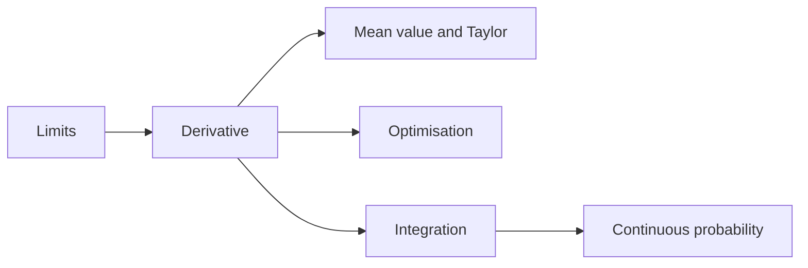

# Calculus and Optimization

> **Paper:** CS+DA · **Priority:** P0/P1

**PYQ weightage:** ~1.5 Qs per CSE paper (2021–26), trend falling; DA: 13 Qs in 2024–26.

Calculus studies local change (derivatives) and accumulated change (integrals). Optimisation uses derivatives to find candidate extrema, then checks constraints and boundaries.

| Order | Chapter | Focus | PYQ weightage |
|---|---|---|---|
| 1 | [Limits, continuity, differentiability](limits-continuity-differentiability.md) | Local behaviour and derivatives | High · 33 |
| 2 | [Mean value theorems and Taylor](mean-value-theorems-and-taylor.md) | Global consequences and approximation | Low · 0 |
| 3 | [Maxima, minima, optimization](maxima-minima-optimization.md) | Critical points and constrained extrema | Medium · 8 |
| 4 | [Integration](integration.md) | Accumulation and area | Medium · 9 |

## Study priority

- [Limits, continuity, differentiability](limits-continuity-differentiability.md) (High · 33) — master limits, continuity tests and differentiation first; over half the section's PYQs, and the DA share is even larger.
- [Integration](integration.md) (Medium · 9) — master definite integrals, integration by parts and substitutions.
- [Maxima, minima, optimization](maxima-minima-optimization.md) (Medium · 8) — master critical points, second-derivative/Hessian tests and constrained extrema.
- [Mean value theorems and Taylor](mean-value-theorems-and-taylor.md) (Low · 0) — no CSE PYQ since 2015; master Rolle/Lagrange mean value theorems and Taylor remainder last, mainly for DA-style derivations.

Connections: [linear algebra](../03-linear-algebra/README.md) supplies quadratic forms; [ML regression](../16-machine-learning/linear-and-logistic-regression.md) minimises loss; [continuous probability](../02-probability-statistics/continuous-distributions.md) integrates densities.

[Cheatsheet](CHEATSHEET.md) · [Checkpoint](CHECKPOINT.md) · [Roadmap](../ROADMAP.md) · [Connections](../CONNECTIONS.md) · [Progress](../PROGRESS.md)
