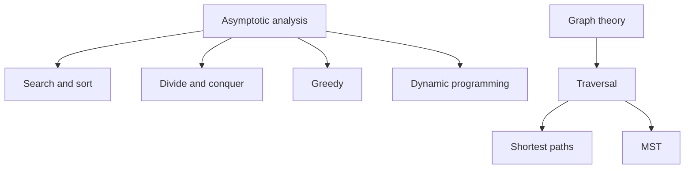

# Algorithms

> **Paper:** CS+DA · **Priority:** P0/P1

**PYQ weightage:** ~7.5 Qs per CSE paper (2021–26), trend steady; DA: 16 Qs in 2024–26.

Learn to state an algorithm precisely, prove why it works, and derive its cost. Asymptotic analysis and data structures are prerequisites; graph algorithms build on graph terminology.

| Order | Chapter | Core idea | PYQ weightage |
|---|---|---|---|
| 1 | [Asymptotic analysis](asymptotic-analysis.md) | Growth, recurrences, bounds | High · 57 |
| 2 | [Searching and sorting](searching-and-sorting.md) | Search and comparison sorts | High · 34 |
| 3 | [Divide and conquer](divide-and-conquer.md) | Recursive decomposition | High · 39 |
| 4 | [Greedy algorithms](greedy-algorithms.md) | Safe local choices | Low · 5 |
| 5 | [Dynamic programming](dynamic-programming.md) | Cache overlapping subproblems | Medium · 6 |
| 6 | [Hashing](hashing.md) | Expected-time dictionary operations | Medium · 11 |
| 7 | [Graph traversals](graph-traversals.md) | Reachability and order | High · 25 |
| 8 | [Minimum spanning trees](minimum-spanning-trees.md) | Cheapest connectivity | High · 22 |
| 9 | [Shortest paths](shortest-paths.md) | Minimise path weight | Low · 5 |

## Study priority

- [Asymptotic analysis](asymptotic-analysis.md) (High · 57) — the highest-weightage chapter in the guide: master recurrence relations, asymptotic notations and identify-the-function questions first.
- [Divide and conquer](divide-and-conquer.md) (High · 39) — master recurrence relations, Quicksort partitioning, binary search variants and merge sort/inversions.
- [Searching and sorting](searching-and-sorting.md) (High · 34) — master sorting traces, Quicksort partitioning and binary search edge cases.
- [Graph traversals](graph-traversals.md) (High · 25) — master BFS/DFS visit sequences, topological sorting, cycle detection and edge classification.
- [Minimum spanning trees](minimum-spanning-trees.md) (High · 22) — master Kruskal's execution, cut and cycle properties and MST uniqueness.
- [Hashing](hashing.md) (Medium · 11) — master linear and double probing and expected-time arguments.
- [Dynamic programming](dynamic-programming.md) (Medium · 6) — master matrix chain multiplication, LCS, 0/1 knapsack and DP state order; the PYQ count understates its syllabus importance.
- [Greedy algorithms](greedy-algorithms.md) (Low · 5) — master Huffman code trees, activity selection, fractional knapsack and job sequencing.
- [Shortest paths](shortest-paths.md) (Low · 5) — master Dijkstra execution traces and heap complexity, Bellman–Ford negative-cycle detection and the Floyd–Warshall recurrence last.

Connections: [data structures](../07-data-structures/README.md) implement queues, heaps, and union-find; [discrete math](../01-discrete-mathematics/README.md) supplies recurrences and graph theory.

[Cheatsheet](CHEATSHEET.md) · [Checkpoint](CHECKPOINT.md) · [Roadmap](../ROADMAP.md) · [Connections](../CONNECTIONS.md) · [Progress](../PROGRESS.md)
