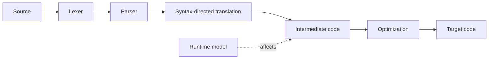

# Compiler Design

> **Paper:** CS · **Priority:** P0/P1

**PYQ weightage:** ~4.5 Qs per CSE paper (2021–26), trend rising; DA: 0 Qs in 2024–26.

A compiler translates source text through representations that expose different questions: tokens, syntax trees, typed/annotated trees, intermediate code, and target instructions. Each pass preserves program meaning while enabling analysis or transformation.

| Order | Chapter | Focus | PYQ weightage |
|---|---|---|---|
| 1 | [Lexical analysis](lexical-analysis.md) | Tokens and finite automata | Medium · 12 |
| 2 | [Parsing](parsing.md) | Grammars and parser tables | High · 33 |
| 3 | [Syntax-directed translation](syntax-directed-translation.md) | Attributes and translation rules | Medium · 11 |
| 4 | [Runtime environments](runtime-environments.md) | Storage, calls, activation records | Low · 3 |
| 5 | [Intermediate code generation](intermediate-code-generation.md) | TAC and control-flow graphs | Medium · 12 |
| 6 | [Optimization and dataflow](optimization-and-dataflow.md) | Local/global transformations | Medium · 7 |

## Study priority

- [Parsing](parsing.md) (High · 33) — the heaviest chapter and the reason the section is rising: master First/Follow, LL and LR parser tables and grammar conflicts first.
- [Lexical analysis](lexical-analysis.md) (Medium · 12) — master compilation phases, tokenization and NFA/DFA-to-regex conversion.
- [Intermediate code generation](intermediate-code-generation.md) (Medium · 12) — master three-address code, basic blocks and DAGs.
- [Syntax-directed translation](syntax-directed-translation.md) (Medium · 11) — master attribute evaluation and abstract syntax trees.
- [Optimization and dataflow](optimization-and-dataflow.md) (Medium · 7) — master live-variable analysis and register allocation.
- [Runtime environments](runtime-environments.md) (Low · 3) — lowest weightage: master activation records and parameter passing last.

Connections: [theory of computation](../11-theory-of-computation/README.md) provides automata and grammars; [data structures](../07-data-structures/README.md) power symbol tables; [architecture](../10-computer-organization/README.md) motivates target code.

[Cheatsheet](CHEATSHEET.md) · [Checkpoint](CHECKPOINT.md) · [Roadmap](../ROADMAP.md) · [Connections](../CONNECTIONS.md) · [Progress](../PROGRESS.md)
