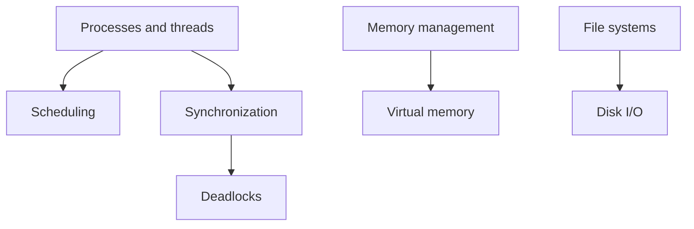

# Operating Systems

> **Paper:** CS · **Priority:** P0/P1

**PYQ weightage:** ~5.0 Qs per CSE paper (2021–26), trend steady; DA: 0 Qs in 2024–26.

An OS multiplexes processors, memory, files, and devices while enforcing protection. Processes provide execution contexts; scheduling chooses who runs; synchronisation coordinates shared state; memory and file systems manage resources.

| Order | Chapter | Focus | PYQ weightage |
|---|---|---|---|
| 1 | [Processes, threads, syscalls](processes-threads-syscalls.md) | Execution and IPC | Medium · 12 |
| 2 | [CPU scheduling](cpu-scheduling.md) | Ready-queue policy and metrics | High · 20 |
| 3 | [Synchronization](synchronization.md) | Critical sections and semaphores | Medium · 14 |
| 4 | [Deadlocks](deadlocks.md) | Resource wait cycles and safety | Medium · 11 |
| 5 | [Memory management](memory-management.md) | Address translation, paging | Low · 4 |
| 6 | [Virtual memory](virtual-memory.md) | Demand paging and replacement | High · 24 |
| 7 | [File systems and disk scheduling](file-systems-and-disk-scheduling.md) | Persistent storage | Medium · 13 |

## Study priority

- [Virtual memory](virtual-memory.md) (High · 24) — master demand paging, page-replacement decisions and TLB arithmetic first.
- [CPU scheduling](cpu-scheduling.md) (High · 20) — master SRTF/SJF, Round Robin, priority scheduling and average waiting-time computation.
- [Synchronization](synchronization.md) (Medium · 14) — master critical sections and semaphore-based solutions.
- [File systems and disk scheduling](file-systems-and-disk-scheduling.md) (Medium · 13) — master inodes, file allocation and disk-scheduling order.
- [Processes, threads, syscalls](processes-threads-syscalls.md) (Medium · 12) — master fork behaviour, threads and context switches.
- [Deadlocks](deadlocks.md) (Medium · 11) — master resource-allocation graphs, Banker's algorithm and prevention/avoidance/detection.
- [Memory management](memory-management.md) (Low · 4) — master paging arithmetic (PYQ books file most of it under Virtual Memory, so treat it as High priority).

Connections: [computer organisation](../10-computer-organization/README.md) explains the hardware boundary; [algorithms](../08-algorithms/README.md) supplies scheduling and graph methods; [networks](../15-computer-networks/README.md) supplies communication.

[Cheatsheet](CHEATSHEET.md) · [Checkpoint](CHECKPOINT.md) · [Roadmap](../ROADMAP.md) · [Connections](../CONNECTIONS.md) · [Progress](../PROGRESS.md)
