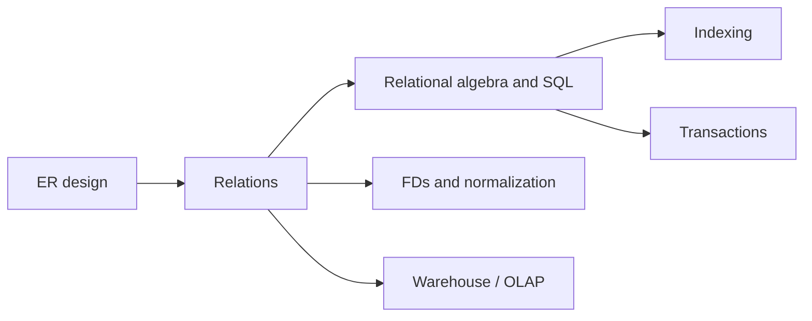

# Databases and Data Warehousing

> **Paper:** CS+DA · **Priority:** P0/P1

**PYQ weightage:** ~5.8 Qs per CSE paper (2021–26), trend falling; DA: 21 Qs in 2024–26.

Databases model facts as relations, query them declaratively, enforce constraints, and coordinate concurrent updates. Learn the relational model before SQL and functional dependencies; then study indexing and transactions. DA adds warehousing and preprocessing.

| Order | Chapter | Focus | PYQ weightage |
|---|---|---|---|
| 1 | [ER model](er-model.md) | Conceptual design | Medium · 8 |
| 2 | [Relational model, algebra, calculus](relational-model-algebra-calculus.md) | Tables and query semantics | High · 29 |
| 3 | [SQL](sql.md) | Practical declarative queries | High · 26 |
| 4 | [Constraints and normalization](constraints-and-normalization.md) | FDs, keys, normal forms | High · 39 |
| 5 | [File organization and indexing](file-organization-and-indexing.md) | Physical lookup | High · 22 |
| 6 | [Transactions and concurrency](transactions-and-concurrency.md) | ACID and serializability | High · 36 |
| 7 | [Warehousing and preprocessing](data-warehousing-and-preprocessing.md) | DA analytical data | Low · 3 |

## Study priority

- [Constraints and normalization](constraints-and-normalization.md) (High · 39) — master normal forms, candidate keys, FDs/minimal cover and lossless-join checks first.
- [Transactions and concurrency](transactions-and-concurrency.md) (High · 36) — master conflict serializability with precedence graphs, recoverability and 2PL/timestamp ordering.
- [Relational model, algebra, calculus](relational-model-algebra-calculus.md) (High · 29) — master relational-algebra operators, tuple calculus and keys/referential integrity.
- [SQL](sql.md) (High · 26) — master nested subqueries, GROUP BY/HAVING, aggregates with NULLs and joins.
- [File organization and indexing](file-organization-and-indexing.md) (High · 22) — master B/B+ tree order and capacity, block-access counts and index types.
- [ER model](er-model.md) (Medium · 8) — master ER-to-relational mapping (minimum tables), cardinality and weak entities.
- [Warehousing and preprocessing](data-warehousing-and-preprocessing.md) (Low · 3) — master star vs snowflake schemas, OLAP operations and feature normalization (DA-weighted).

Connections: [compiler parsing](../12-compiler-design/parsing.md) handles query syntax; [OS file systems](../13-operating-systems/file-systems-and-disk-scheduling.md) provide storage; [ML](../16-machine-learning/README.md) consumes prepared features.

[Cheatsheet](CHEATSHEET.md) · [Checkpoint](CHECKPOINT.md) · [Roadmap](../ROADMAP.md) · [Connections](../CONNECTIONS.md) · [Progress](../PROGRESS.md)
