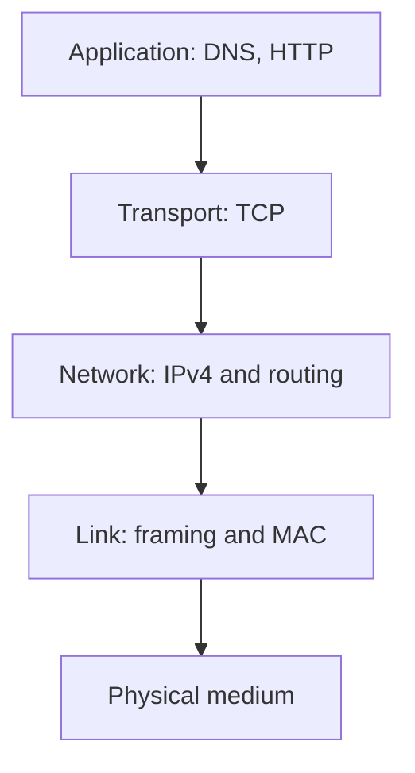

# Computer Networks

> **Paper:** CS · **Priority:** P0/P1

**PYQ weightage:** ~5.3 Qs per CSE paper (2021–26), trend steady; DA: 0 Qs in 2024–26.

Networks move data across links with different scopes: link protocols deliver frames on one link, IP routes packets across networks, transport provides process-to-process service, and applications define useful exchanges. Use the 2027 syllabus scope in [coverage](../COVERAGE.md); older PYQs can include legacy protocols not named in the current syllabus.

| Order | Chapter | Focus | PYQ weightage |
|---|---|---|---|
| 1 | [Layering, switching, performance](layering-switching-performance.md) | Delay, throughput, switching | Medium · 6 |
| 2 | [Data link](data-link-layer.md) | Error detection and MAC | High · 23 |
| 3 | [Routing](routing.md) | Distance-vector and link-state | Medium · 9 |
| 4 | [IPv4 addressing](ipv4-addressing.md) | Subnets, CIDR, NAT | High · 31 |
| 5 | [TCP and transport](transport-layer-tcp.md) | Flow/congestion, sockets | High · 21 |
| 6 | [Application layer](application-layer.md) | DNS and HTTP | Medium · 6 |

## Study priority

- [IPv4 addressing](ipv4-addressing.md) (High · 31) — master subnetting/CIDR allocation, header fields and checksum, fragmentation and ARP/ICMP first.
- [Data link](data-link-layer.md) (High · 23) — master sliding-window (Go-Back-N/selective-repeat) efficiency, CSMA/CD sizing and CRC division.
- [TCP and transport](transport-layer-tcp.md) (High · 21) — master congestion control (slow start, AIMD, threshold), sequence numbers, flow control and the 3-way handshake.
- [Routing](routing.md) (Medium · 9) — master distance-vector/count-to-infinity, link-state/Dijkstra trees and next-hop lookup.
- [Layering, switching, performance](layering-switching-performance.md) (Medium · 6) — master packet vs circuit switching delay, transmission vs propagation delay and bandwidth-delay product.
- [Application layer](application-layer.md) (Medium · 6) — master HTTP persistent vs non-persistent RTT math, DNS resolution and mail/FTP basics.

Connections: [OS sockets](../13-operating-systems/processes-threads-syscalls.md) connect applications to transport; [graph algorithms](../08-algorithms/shortest-paths.md) underpin route calculation; [COA I/O](../10-computer-organization/io-interrupts-dma.md) covers device transfer.

[Cheatsheet](CHEATSHEET.md) · [Checkpoint](CHECKPOINT.md) · [Roadmap](../ROADMAP.md) · [Connections](../CONNECTIONS.md) · [Progress](../PROGRESS.md)
