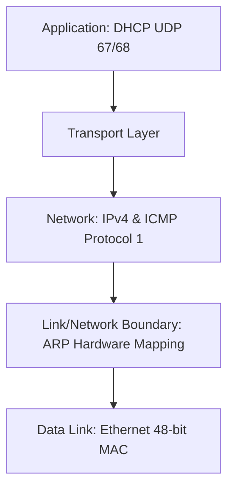

# IPv4 Addressing, Subnetting, and Network Protocols

> **Paper:** CS · **Priority:** P0 · **Plan topics:** IPv4 addressing, subnetting, CIDR, supernetting, fragmentation, IPv4 header, NAT, ARP, ICMP, DHCP
> **Prerequisites:** [Layering and performance](layering-switching-performance.md) · **Leads to:** [Routing](routing.md), [TCP and transport](transport-layer-tcp.md)
> **PYQ weightage:** High · 31 Qs since 2015 (17 since 2021) · DA: 0 · Trend: rising · Most asked: Subnetting & CIDR allocation, IPv4 header fields & checksum, IP fragmentation (offset & MF), ARP & ICMP

## Quick glance

- **Exam focus:** Subnet design (splitting/aggregating blocks, usable host range), IP fragmentation arithmetic (Offset in 8-byte units, MF flag, total overhead), IPv4 header fields (HLEN in 4-byte words, Total Length, TTL decrement), and ARP/NAT mechanics. Highly numerical; heavily tested via NAT and MCQ/MSQ.
- IPv4 address is 32 bits ($4$ octets). Classful boundaries: Class A (`0...`, `/8`), Class B (`10...`, `/16`), Class C (`110...`, `/24`), Class D (multicast `1110...`, `224.0.0.0/4`), Class E (reserved `1111...`, `240.0.0.0/4`).
- **CIDR prefix `/p`:** $p$ network bits, $32-p$ host bits. Block size $= 2^{32-p}$.
- **Usable hosts:** $2^{32-p} - 2$ in standard subnets (first address = Network ID with host bits all 0; last address = Directed Broadcast Address (DBA) with host bits all 1). RFC 3021 allows $2$ usable hosts in `/31` point-to-point links.
- **Subnetting (borrowing host bits):** Borrowing $k$ bits yields $2^k$ subnets, each with $2^{(32-p-k)} - 2$ usable hosts.
- **Supernetting (CIDR aggregation):** Combine $2^k$ contiguous equal-sized blocks where the base network address is a multiple of total combined size.
- **IPv4 Header:** 20 to 60 bytes. **HLEN** (4 bits) has scaling factor of **4 bytes** ($\text{Header length} = \text{HLEN} \times 4$). Total Length (16 bits) is in **bytes** (max 65,535 B). Payload $= \text{Total Length} - (\text{HLEN} \times 4)$.
- **Fragmentation:** MTU includes IP header. Fragment Offset is in **8-byte units** ($\text{Offset} = \text{Byte offset}/8$). All non-terminal fragments must carry data payload as a **multiple of 8 bytes**, with $\text{MF} = 1$. Terminal fragment has $\text{MF} = 0$. $\text{DF} = 1$ forbids fragmentation (router drops packet and sends ICMP Type 3 Code 4).
- **TTL (Time to Live):** Decremented by at least 1 at every router hop. If $\text{TTL} = 0$, packet is discarded and ICMP Time Exceeded (Type 11) sent to source.
- **ARP:** Maps 32-bit IPv4 address to 48-bit MAC address. Request is broadcast (FF:FF:FF:FF:FF:FF); reply is unicast.
- **NAT:** Rewrites private IPs (`10.0.0.0/8`, `172.16.0.0/12`, `192.168.0.0/16`) to public IP. NAPT/PAT uses 16-bit transport port numbers to multiplex thousands of internal hosts behind 1 public IP.

## 1. Classful vs CIDR Addressing and Subnetting [PYQ: High]

An IPv4 address is an identifier assigned to a network interface, represented as 32 bits divided into 4 octets in dotted-decimal notation (e.g., `192.168.1.1`).

### Classful addressing

| Class | Leading bits | Network bits | Host bits | First octet range | Default mask | Number of networks | Hosts per network |
|---|---|---|---|---|---|---|---|
| **A** | `0` | 8 (7 effective) | 24 | `1` to `126` (`127` loopback) | `255.0.0.0` (/8) | $2^7 - 2 = 126$ | $2^{24} - 2 \approx 16.7\text{M}$ |
| **B** | `10` | 16 (14 effective) | 16 | `128` to `191` | `255.255.0.0` (/16) | $2^{14} = 16,384$ | $2^{16} - 2 = 65,534$ |
| **C** | `110` | 24 (21 effective) | 8 | `192` to `223` | `255.255.255.0` (/24) | $2^{21} \approx 2.09\text{M}$ | $2^8 - 2 = 254$ |
| **D** | `1110` | — | — | `224` to `239` | Multicast group ID | — | — |
| **E** | `1111` | — | — | `240` to `255` | Experimental / Reserved | — | — |

Special IPv4 addresses:
- `0.0.0.0/32`: This host on this network (used as source during DHCP bootstrapping).
- `255.255.255.255/32`: Limited broadcast address (never forwarded across routers).
- `127.0.0.0/8`: Loopback network (e.g., `127.0.0.1` refers to localhost).
- Private IP ranges (RFC 1918): `10.0.0.0/8`, `172.16.0.0/12` (`172.16.0.0`–`172.31.255.255`), `192.168.0.0/16`.

### CIDR and Subnet mask mechanics

Classless Inter-Domain Routing (CIDR, RFC 4632) eliminates rigid class boundaries using a prefix `/p`:
- **Network ID (Subnet ID):** Bitwise AND of IP address and Subnet Mask: $\text{NetID} = \text{IP} \ \& \ \text{Mask}$.
- **Directed Broadcast Address (DBA):** Set all $32-p$ host bits to `1`.
- **Block size:** $2^{32-p}$.
- **Usable host addresses:** $2^{32-p} - 2$ (excluding NetID and DBA).

When borrowing $k$ bits from the host portion of a `/p` block, the new prefix is $p' = p + k$, yielding $2^k$ subnets with $2^{32 - p - k} - 2$ usable hosts each.

**Worked example 1 (VLSM address allocation).** An organization is assigned `198.51.100.0/24`. It needs to create four subnets:
- Dept A: 100 hosts | Dept B: 50 hosts | Dept C: 25 hosts | Dept D: 10 hosts

Design the Variable Length Subnet Mask (VLSM) allocation.

**Step-by-step solution:**
1. Sort requirements in descending order: A (100) $\to$ B (50) $\to$ C (25) $\to$ D (10).
2. **Dept A (100 hosts):** Need $2^h - 2 \ge 100 \implies h = 7$ bits. Prefix $= 32 - 7 = /25$. Mask $= 255.255.255.128$.
   - Network ID: `198.51.100.0/25`; Range: `198.51.100.1`–`198.51.100.126`; DBA: `198.51.100.127`.
3. **Dept B (50 hosts):** Need $2^h - 2 \ge 50 \implies h = 6$ bits. Prefix $= 32 - 6 = /26$. Mask $= 255.255.255.192$.
   - Network ID: `198.51.100.128/26`; Range: `198.51.100.129`–`198.51.100.190`; DBA: `198.51.100.191`.
4. **Dept C (25 hosts):** Need $2^h - 2 \ge 25 \implies h = 5$ bits. Prefix $= 32 - 5 = /27$. Mask $= 255.255.255.224$.
   - Network ID: `198.51.100.192/27`; Range: `198.51.100.193`–`198.51.100.222`; DBA: `198.51.100.223`.
5. **Dept D (10 hosts):** Need $2^h - 2 \ge 10 \implies h = 4$ bits. Prefix $= 32 - 4 = /28$. Mask $= 255.255.255.240$.
   - Network ID: `198.51.100.224/28`; Range: `198.51.100.225`–`198.51.100.238`; DBA: `198.51.100.239`.
   - Remaining unassigned pool: `198.51.100.240/28` (16 addresses, `.240` to `.255`).

## 2. CIDR Aggregation (Supernetting) and Longest Prefix Match [PYQ: High]

### Supernetting rules
Supernetting combines multiple contiguous smaller CIDR blocks into a single routing entry. Three conditions must hold to aggregate $N$ blocks into a supernet:
1. $N$ must be a power of $2$ ($N = 2^k$).
2. All $N$ blocks must be contiguous and of identical size ($/p$).
3. The starting address of the first block must be divisible by the total number of addresses in the supernet ($N \times 2^{32-p}$). In binary, the last $32 - (p - k)$ bits must be all `0`.

### Longest Prefix Match (LPM)
Routers do not stop at the first matching route in the table. When multiple routing entries match a destination IP address, the router forwards via the entry with the **longest prefix length** (most specific route).

**Worked example 2 (Routing table LPM trace).** A router has the following forwarding table:
- Entry 1: `128.96.168.0/21` $\to$ Interface $I_0$ (Range: `128.96.168.0` – `128.96.175.255`)
- Entry 2: `128.96.168.0/22` $\to$ Interface $I_1$ (Range: `128.96.168.0` – `128.96.171.255`)
- Entry 3: `128.96.168.0/24` $\to$ Interface $I_2$ (Range: `128.96.168.0` – `128.96.168.255`)
- Entry 4: `0.0.0.0/0` (Default) $\to$ Interface $I_3$

Determine the outgoing interface for packets with destination IPs:
1. `128.96.168.45` $\to$ Matches `/24`, `/22`, `/21`, Default. Longest is `/24` $\implies$ **Interface $I_2$**.
2. `128.96.170.12` $\to$ 3rd octet 170. Matches `/22`, `/21`, Default. Longest is `/22` $\implies$ **Interface $I_1$**.
3. `128.96.174.1` $\to$ 3rd octet 174. Matches `/21`, Default. Longest is `/21` $\implies$ **Interface $I_0$**.
4. `128.96.176.1` $\to$ 3rd octet 176 exceeds `/21` ceiling (175). Matches only default $\implies$ **Interface $I_3$**.

## 3. IPv4 Header Architecture and Field Calculations [PYQ: High]

```text
 0                   1                   2                   3
 0 1 2 3 4 5 6 7 8 9 0 1 2 3 4 5 6 7 8 9 0 1 2 3 4 5 6 7 8 9 0 1
+-+-+-+-+-+-+-+-+-+-+-+-+-+-+-+-+-+-+-+-+-+-+-+-+-+-+-+-+-+-+-+-+
|Version|  IHL  |Type of Service|          Total Length         |
+-+-+-+-+-+-+-+-+-+-+-+-+-+-+-+-+-+-+-+-+-+-+-+-+-+-+-+-+-+-+-+-+
|         Identification        |Flags|      Fragment Offset    |
+-+-+-+-+-+-+-+-+-+-+-+-+-+-+-+-+-+-+-+-+-+-+-+-+-+-+-+-+-+-+-+-+
|  Time to Live |    Protocol   |        Header Checksum        |
+-+-+-+-+-+-+-+-+-+-+-+-+-+-+-+-+-+-+-+-+-+-+-+-+-+-+-+-+-+-+-+-+
|                       Source IP Address                       |
+-+-+-+-+-+-+-+-+-+-+-+-+-+-+-+-+-+-+-+-+-+-+-+-+-+-+-+-+-+-+-+-+
|                    Destination IP Address                     |
+-+-+-+-+-+-+-+-+-+-+-+-+-+-+-+-+-+-+-+-+-+-+-+-+-+-+-+-+-+-+-+-+
|                    Options (if any) ...                       |
+-+-+-+-+-+-+-+-+-+-+-+-+-+-+-+-+-+-+-+-+-+-+-+-+-+-+-+-+-+-+-+-+
```

### Critical header fields and scaling factors
1. **Version (4 bits):** Value `4` for IPv4 (`0100` in binary).
2. **IHL / HLEN (4 bits):** Internet Header Length in **4-byte words (32-bit words)**.
   - Minimum value: `5` ($5 \times 4 = 20$ bytes, no options). Maximum: `15` ($15 \times 4 = 60$ bytes).
   - $\text{Header Length in bytes} = \text{IHL} \times 4$.
3. **Total Length (16 bits):** Entire datagram length (header + payload) in **bytes**.
   - Maximum datagram size $= 2^{16} - 1 = 65,535$ bytes.
   - $\text{Data Payload Size} = \text{Total Length} - (\text{IHL} \times 4)$.
4. **Identification (16 bits):** Uniquely identifies original datagram for reassembly.
5. **Flags (3 bits):** Bit 0: Reserved (`0`). Bit 1: **DF (Don't Fragment)**; if `1`, packet must not be fragmented. Bit 2: **MF (More Fragments)**; if `1`, more fragments follow; if `0`, last fragment.
6. **Fragment Offset (13 bits):** Position of data in original datagram measured in **8-byte units**.
   - $\text{Byte Offset} = \text{Fragment Offset} \times 8$.
7. **Time to Live / TTL (8 bits):** Hop counter to prevent routing loops. Decremented by $\ge 1$ at every router. If $\text{TTL} = 0$, packet is discarded and ICMP Time Exceeded (Type 11 Code 0) sent to sender.
8. **Protocol (8 bits):** `1`: ICMP, `2`: IGMP, `6`: TCP, `17`: UDP, `89`: OSPF.
9. **Header Checksum (16 bits):** Covers **IPv4 header only** (not data payload). Calculated as 16-bit 1's complement sum. Recomputed at every router because TTL decrements.

**Worked example 3 (Header hex dump decoding).** The first 20 bytes of an IP packet received at a router in hexadecimal format are:
`45 00 01 C8 1C 57 00 00 40 06 B1 E2 C0 A8 01 0A C0 A8 01 14`
Extract:
1. IP version and header length: First byte `45` $\implies$ Version `4` (IPv4), $\text{IHL} = 5 \implies 5 \times 4 = 20$ bytes.
2. Total packet length: Bytes 2–3 are `01 C8` $\implies 1 \times 256 + 200 = 456$ bytes.
3. Payload size: $456 - 20 = 436$ bytes.
4. TTL value: Byte 8 is `40` (hex) $= 64$ (decimal).
5. Protocol: Byte 9 is `06` (hex) $= 6$ (decimal) $\implies$ **TCP**.

## 4. IP Packet Fragmentation and Reassembly [PYQ: Medium]

When a router forwards a datagram onto a link whose **Maximum Transmission Unit (MTU)** is smaller than the datagram's Total Length, it must fragment the datagram (unless DF=1).

### Essential fragmentation rules
1. **Header copying:** Each fragment gets its own 20-byte IP header with the same Identification as the original.
2. **Payload chunk size:** The data payload of every fragment (except possibly the last) **must be an exact multiple of 8 bytes**:
   $$\text{Max data payload per fragment} = \left\lfloor \frac{\text{MTU} - \text{Header Length}}{8} \right\rfloor \times 8$$
3. **Offset calculation:** $\text{Offset}_i = (\sum_{j=1}^{i-1} \text{Payload}_j) / 8$.
4. **Flags:** All fragments except the last have $\text{MF} = 1$. The final fragment has $\text{MF} = 0$.
5. **Reassembly:** Performed **strictly at the final destination host**, never at intermediate routers.

**Worked example 4 (Complete fragmentation numerical).** An IPv4 datagram of Total Length $4400$ bytes (20 bytes base header and 4380 bytes data) arrives at a router. It must be forwarded over an outgoing network with $\text{MTU} = 1500$ bytes.
1. Max data payload per fragment $= \lfloor (1500 - 20) / 8 \rfloor \times 8 = \lfloor 1480 / 8 \rfloor \times 8 = 185 \times 8 = 1480$ bytes.
2. Total fragments $= \lceil 4380 / 1480 \rceil = \lceil 2.959 \rceil = 3$ fragments.
3. Parameters per fragment:
   - **Fragment 1:** Data $= 1480$ B (bytes 0–1479). $\text{Total Length} = 1500$ B. $\text{Offset} = 0/8 = 0$. $\text{MF} = 1$.
   - **Fragment 2:** Data $= 1480$ B (bytes 1480–2959). $\text{Total Length} = 1500$ B. $\text{Offset} = 1480/8 = 185$. $\text{MF} = 1$.
   - **Fragment 3:** Data $= 4380 - 2960 = 1420$ B (bytes 2960–4379). $\text{Total Length} = 1440$ B. $\text{Offset} = 2960/8 = 370$. $\text{MF} = 0$.

## 5. Support Protocols: ARP, ICMP, DHCP, and NAT [PYQ: High]



### 5.1 Address Resolution Protocol (ARP)
- Resolves an IP address (Network Layer) to a physical MAC address (Data Link Layer) on the same local broadcast domain.
- **ARP Request:** Sent as a link-layer **Broadcast** (`FF:FF:FF:FF:FF:FF`).
- **ARP Reply:** Sent as a link-layer **Unicast** directly to the requester.
- **Gratuitous ARP:** Host broadcasts an ARP request for its own IP to detect duplicate IPs or update switch CAM tables.

### 5.2 Internet Control Message Protocol (ICMP)
Encapsulated directly inside IPv4 (Protocol = `1`). Reports errors and diagnostic queries.
- **Error reporting:** `Type 3` (Destination Unreachable; Code 4: Fragmentation needed but DF set), `Type 11` (Time Exceeded; Code 0: TTL expired in transit — used by `traceroute`), `Type 12` (Parameter Problem).
- **Queries:** `Type 8 / Type 0` (Echo Request / Echo Reply — used by `ping`).
- **Rules where ICMP error is NEVER sent:** In response to another ICMP error message, a fragmented datagram (other than the first fragment), or a multicast/broadcast datagram.

### 5.3 Dynamic Host Configuration Protocol (DHCP)
Operates at application layer over **UDP** (Server port 67, Client port 68). Automates IP configuration using the **DORA** transaction:
1. **Discover:** Client broadcasts (`Src: 0.0.0.0:68, Dst: 255.255.255.255:67`).
2. **Offer:** DHCP Server provides proposed IP, subnet mask, default gateway, DNS server, lease time.
3. **Request:** Client broadcasts accepting the offer.
4. **Acknowledge (ACK):** Server confirms the IP binding.

### 5.4 Network Address Translation (NAT / NAPT)
Enables multiple hosts with private IP addresses (RFC 1918) to share a single public IP address.
- **NAPT / PAT:** Maps `(Private IP, Private Port)` to `(Public IP, Public Port)`.
- Outgoing: Router rewrites source IP and port; logs entry in NAT table.
- Incoming: Router checks destination IP and port; rewrites to internal private IP and port.

**Worked example 5 (NAPT translation trace).** Internal host `192.168.1.10:5000` contacts web server `93.184.216.34:80` via NAT router with public IP `203.0.113.5` (allocated port `40000`).
- **LAN packet:** `Src: 192.168.1.10:5000` $\to$ `Dst: 93.184.216.34:80`.
- **Public packet:** Router rewrites: `Src: 203.0.113.5:40000` $\to$ `Dst: 93.184.216.34:80`.
- **Response packet:** Arrives as `Src: 93.184.216.34:80` $\to$ `Dst: 203.0.113.5:40000`. Router looks up NAT table and translates to `Dst: 192.168.1.10:5000`.

## Formulas and facts to memorise

| Item | Formula / Fact | When to use |
|---|---|---|
| Total addresses in `/p` | $2^{32-p}$ | Sizing any CIDR block |
| Usable hosts in `/p` | $2^{32-p} - 2$ (for $p \le 30$) | Host capacity calculations |
| Subnet borrowing $k$ bits | $2^k$ subnets, $2^{32-p-k} - 2$ hosts | Subnet splitting problems |
| IPv4 Header Length | $\text{IHL} \times 4$ bytes ($\text{IHL} \in [5, 15]$) | Extracting payload from datagram |
| Data payload size | $\text{Total Length} - (\text{IHL} \times 4)$ | Datagram payload calculation |
| Max fragment payload | $\lfloor (\text{MTU} - 20) / 8 \rfloor \times 8$ | IP packet fragmentation |
| Fragment Offset | $\text{Cumulative Data Bytes} / 8$ | Fragmentation header fields |
| Number of fragments | $\lceil \text{Total Data} / \text{Max Fragment Payload} \rceil$ | Packet splitting across small MTU |
| TTL decrement | Decremented by 1 at every router hop | Traceroute, loop detection |
| ARP packets | Request: Broadcast; Reply: Unicast | Local MAC address resolution |
| ICMP encapsulation | Direct in IP (Protocol 1) | Error and diagnostic packets |

## GATE traps

- **Offset unit is 8 bytes, not 1 byte:** If Fragment Offset $= 185$, the starting byte is $185 \times 8 = 1480$.
- **MTU includes the IP header:** If MTU is 1500 bytes, data payload capacity is $1500 - 20 = 1480$ bytes.
- **Subnetting host count subtraction:** Always subtract $2$ for standard subnets ($p \le 30$). If a question asks for *addresses*, answer $2^{32-p}$; if it asks for *usable hosts*, answer $2^{32-p} - 2$.
- **Longest prefix match:** Never pick the first entry that matches the destination IP. Find all matching entries and select the one with the highest prefix length `/p`.
- **HLEN scaling:** The IHL field is in 4-byte words. $\text{IHL} = 5 \implies 20$ bytes; $\text{IHL} = 15 \implies 60$ bytes.
- **Reassembly location:** Routers fragment packets; routers **never** reassemble fragments. Reassembly occurs exclusively at the destination host.
- **ICMP errors for ICMP:** An ICMP error message is never generated in response to another ICMP error message.

## Connections

- [Layering and performance](layering-switching-performance.md) — Link-layer MTU enforces network-layer fragmentation; packet transmission delays depend on total packet sizes.
- [Routing](routing.md) — Routing protocols populate the forwarding tables that execute longest-prefix matching.
- [TCP and transport](transport-layer-tcp.md) — TCP segments are encapsulated as the data payload of IPv4 datagrams; NAPT tracks TCP port numbers.
- [Application layer](application-layer.md) — DHCP operates as an application-layer service over UDP to configure IPv4 network parameters.

## Practice

**Q1 (MCQ).** An IP router with an MTU of 200 bytes receives an IP packet of length 900 bytes with an IP header of length 20 bytes. The value of the `Fragment Offset` field in the 3rd fragment is:
(A) 22  
(B) 44  
(C) 176  
(D) 352  

<details><summary>Answer</summary>

**Answer:** (B)  
**Solution:**
1. Data payload $= 900 - 20 = 880$ bytes. Max payload per fragment $= \lfloor (200 - 20) / 8 \rfloor \times 8 = 176$ bytes.
2. Fragment 1: bytes 0–175. $\text{Offset} = 0/8 = 0$.
3. Fragment 2: bytes 176–351. $\text{Offset} = 176/8 = 22$.
4. Fragment 3: bytes starting at 352. $\text{Offset} = 352/8 = 44$.
Hence, option (B) is correct.

</details>

**Q2 (NAT).** An organization has a Class C network `200.10.20.0/24` and wishes to form 5 subnets, such that each subnet can accommodate at least 25 hosts. What is the maximum number of additional subnets of the same size that can be created from this network?

<details><summary>Answer</summary>

**Answer:** 3  
**Solution:**
1. At least 25 hosts requires $2^h - 2 \ge 25 \implies h = 5$ bits ($2^5 - 2 = 30 \ge 25$).
2. In `/24`, 8 host bits exist. Bits borrowed for subnetting $k = 8 - 5 = 3$ bits.
3. Total subnets $= 2^3 = 8$.
4. Additional subnets $= 8 - 5 = 3$.

</details>

**Q3 (NAT).** In an IPv4 packet, the value of the `HLEN` field is `1000` in binary, and the value of the `Total Length` field is `00000100 00000000` in binary. How many bytes of data payload are carried by this packet?

<details><summary>Answer</summary>

**Answer:** 992  
**Solution:**
1. $\text{HLEN} = 1000_2 = 8_{10} \implies \text{Header Length} = 8 \times 4 = 32$ bytes.
2. $\text{Total Length} = 00000100 \ 00000000_2 = 1024$ bytes.
3. $\text{Data Payload} = 1024 - 32 = 992$ bytes.

</details>

**Q4 (MSQ).** Which of the following statements about IPv4, ARP, and ICMP are **CORRECT**?
(A) ARP requests are broadcast at the data link layer, while ARP replies are unicast.  
(B) A router reassembles fragmented IP packets before forwarding them to the next hop.  
(C) An ICMP error message is never generated in response to an ICMP error message.  
(D) If the DF bit is 1 and packet size exceeds MTU, the router drops the packet and sends an ICMP Type 3 Code 4 message.  

<details><summary>Answer</summary>

**Answer:** (A), (C), (D)  
**Solution:**
- (A) is correct: ARP request is broadcast; reply is unicast.
- (B) is incorrect: Routers never reassemble fragments; reassembly occurs strictly at the destination host.
- (C) is correct: Prevents broadcast storms and infinite loops.
- (D) is correct: Dropping with ICMP Destination Unreachable (Fragmentation Needed) is standard PMTU discovery.

</details>

**Q5 (MCQ).** Consider three IP networks: $N_1 = 192.168.0.0/24$, $N_2 = 192.168.1.0/24$, and $N_3 = 192.168.2.0/24$. An administrator wants to supernet them into a single routing prefix. Which of the following statements is TRUE?
(A) $N_1, N_2, N_3$ can be aggregated into a single `/22` prefix $192.168.0.0/22$.  
(B) $N_1, N_2, N_3$ can be aggregated into a single `/23` prefix $192.168.0.0/23$.  
(C) $N_1, N_2, N_3$ cannot be aggregated into a single prefix without including unassigned network $192.168.3.0/24$.  
(D) $N_1, N_2, N_3$ cannot be aggregated because their base addresses are not divisible by 3.  

<details><summary>Answer</summary>

**Answer:** (C)  
**Solution:**
Supernetting requires the number of blocks to be a power of 2. The smallest power of 2 covering 3 `/24` networks is $4$ blocks ($2^2$), which forms a `/22` network ($192.168.0.0/22$) spanning `.0.0/24` through `.3.0/24`. Aggregating them into one prefix requires including `192.168.3.0/24`.

</details>

**Q6 (NAT).** A router has forwarding table prefixes: $R_1$: `202.16.0.0/16`, $R_2$: `202.16.64.0/18`, $R_3$: `202.16.68.0/22`, $R_4$: `202.16.68.0/24`. A packet with destination IP `202.16.68.150` arrives. To which prefix entry will the router match and forward this packet? (Write $1$ for $R_1$, $2$ for $R_2$, $3$ for $R_3$, $4$ for $R_4$).

<details><summary>Answer</summary>

**Answer:** 4  
**Solution:**
All four prefixes match `202.16.68.150`. By Longest Prefix Match, the router selects the entry with the longest prefix length, which is $R_4$ (/24). Hence, the answer is 4.

</details>

**Q7 (NAT).** An IP datagram of size 1200 bytes (including a 20-byte IP header) is fragmented across a link with MTU 400 bytes. Each fragment carries a 20-byte IP header. What is the total number of bytes of IP header transmitted across all fragments for this datagram?

<details><summary>Answer</summary>

**Answer:** 80  
**Solution:**
1. Data payload $= 1200 - 20 = 1180$ bytes.
2. Max payload per fragment $= \lfloor (400 - 20) / 8 \rfloor \times 8 = 376$ bytes.
3. Number of fragments $= \lceil 1180 / 376 \rceil = 4$ fragments (payloads: 376, 376, 376, 52 bytes).
4. Total IP header bytes $= 4 \times 20 = 80$ bytes.

</details>
