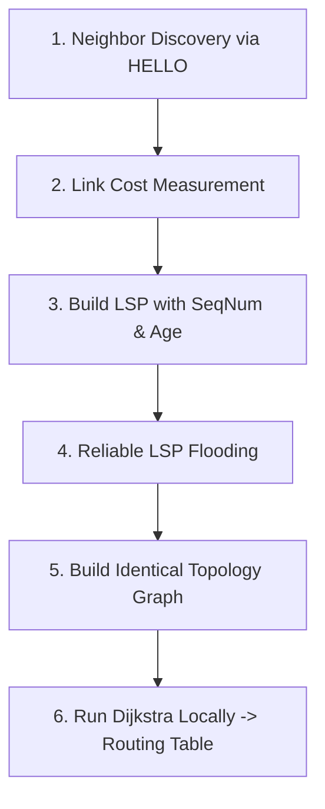

# Routing Protocols: Distance-Vector, Link-State, and Forwarding

> **Paper:** CS · **Priority:** P0 · **Plan topics:** routing, distance-vector, link-state, forwarding, Dijkstra, Bellman-Ford, count-to-infinity, split horizon, RIP, OSPF, BGP
> **Prerequisites:** [Graph theory](../01-discrete-mathematics/graph-theory.md), [Shortest paths](../08-algorithms/shortest-paths.md), [IPv4 addressing](ipv4-addressing.md) · **Leads to:** [TCP and transport](transport-layer-tcp.md)
> **PYQ weightage:** Medium · 9 Qs since 2015 (7 since 2021) · DA: 0 · Trend: rising · Most asked: Distance Vector Routing & count-to-infinity, Link State & Dijkstra shortest path tree, Routing table lookup & next-hop determination

## Quick glance

- **Exam focus:** Bellman-Ford distance vector updates ($D_x(y) = \min_v [c(x,v) + D_v(y)]$), tracing count-to-infinity on link failure, Split Horizon & Poison Reverse mechanisms, Link State Dijkstra tree execution, and protocol comparisons (RIP vs OSPF vs BGP). Frequently asked via NAT (vector tables after iterations) and MCQ/MSQ (protocol attributes).
- **Routing vs Forwarding:** Routing (control plane) computes global network paths and populates tables; forwarding (data plane) transfers packets from router input link to output link using table lookup.
- **Distance Vector Routing (DVR):** Distributed Bellman-Ford. Nodes periodically exchange their complete distance vectors with **immediate neighbours only**.
- **Good news travels fast; bad news travels slowly:** Cost reductions propagate in 1–2 iterations; link failures/increases trigger persistent loops and the **count-to-infinity** problem.
- **Loop mitigation:** Define small $\infty$ (e.g. 16 in RIP); **Split Horizon** (do not advertise a learned route back to the neighbor through which it was learned); **Poison Reverse** (advertise the route back with metric $\infty$). Solves 2-node loops; does not prevent 3+ node loops.
- **Link State Routing (LSR):** Global map approach. Every node discovers neighbors and costs, creates a Link State Packet (LSP), **floods** LSPs reliably across the entire network, and independently runs **Dijkstra's algorithm** to compute its shortest path tree.
- **Interior vs Exterior Protocols:**
  - **RIP:** Intra-AS, Distance Vector, hop count metric (max 15, $\infty=16$), updates every 30s over UDP port 520.
  - **OSPF:** Intra-AS, Link State, Dijkstra-based, cost/bandwidth metric, supports hierarchical areas, runs directly over IP (protocol 89).
  - **BGP-4:** Inter-AS, Path Vector, carries entire AS-PATH attribute over TCP port 179 to detect and discard loops, policy-driven.

## 1. Distance Vector Routing and Bellman–Ford Updates [PYQ: Medium]

In Distance Vector Routing (DVR), each router maintains a vector of estimated minimum costs to all destinations in the network.

### The distributed Bellman–Ford equation
Let $c(x, v)$ be the direct link cost from node $x$ to direct neighbor $v$, and let $D_v(y)$ be the cost from neighbor $v$ to destination $y$ reported in $v$'s distance vector. Router $x$ updates its distance to destination $y$ as:
$$D_x(y) = \min_{v \in \text{Neighbors}(x)} \{ c(x, v) + D_v(y) \}$$

The next hop for destination $y$ is the neighbor $v^*$ that achieves this minimum.

```text
Router x Table: Destination y
  Candidate via Neighbor A: c(x, A) + D_A(y)
  Candidate via Neighbor B: c(x, B) + D_B(y)   <-- MINIMUM
  Candidate via Neighbor C: c(x, C) + D_C(y)
  ==> Next Hop for y = B, Cost = min value
```

### Update cycle
1. Each node sends its distance vector to all adjacent neighbors periodically (e.g., every 30 seconds) or when a local link cost changes (triggered update).
2. When node $x$ receives a vector from neighbor $v$, it recalculates all $D_x(y)$.
3. If any distance or next hop changes, node $x$ sends its new vector to its neighbors.

**Worked example 1 (Distance vector recalculation).** Consider a 4-node network ($A, B, C, D$). Node $B$ is directly connected to $A, C, D$ with link costs:
- $c(B, A) = 2$
- $c(B, C) = 1$
- $c(B, D) = 7$

Node $B$ receives distance vectors from its neighbors:
- From $A$: $D_A = [A: 0, B: 2, C: 4, D: 3]$
- From $C$: $D_C = [A: 4, B: 1, C: 0, D: 2]$
- From $D$: $D_D = [A: 3, B: 7, C: 2, D: 0]$

Compute the updated distance vector and routing table for router $B$.

**Step-by-step solution:**
Apply $D_B(y) = \min_v \{ c(B, v) + D_v(y) \}$ for each destination $y \in \{A, B, C, D\}$:
1. **Destination $A$:**
   - via $A$: $c(B, A) + D_A(A) = 2 + 0 = 2$
   - via $C$: $c(B, C) + D_C(A) = 1 + 4 = 5$
   - via $D$: $c(B, D) + D_D(A) = 7 + 3 = 10$
   - $\min = 2 \implies$ Cost to $A = 2$, Next Hop $= A$.
2. **Destination $B$:**
   - Direct local host $\implies$ Cost $= 0$, Next Hop $= \text{Local}$.
3. **Destination $C$:**
   - via $A$: $2 + 4 = 6$
   - via $C$: $1 + 0 = 1$
   - via $D$: $7 + 2 = 9$
   - $\min = 1 \implies$ Cost to $C = 1$, Next Hop $= C$.
4. **Destination $D$:**
   - via $A$: $c(B, A) + D_A(D) = 2 + 3 = 5$
   - via $C$: $c(B, C) + D_C(D) = 1 + 2 = 3$
   - via $D$: $c(B, D) + D_D(D) = 7 + 0 = 7$
   - $\min = 3 \implies$ Cost to $D = 3$, Next Hop $= C$.

Notice that although direct link $B-D$ costs $7$, the path via $C$ ($B \to C \to D$) costs only $1 + 2 = 3$.

**Updated Routing Table at $B$:**

| Destination | Cost | Next Hop |
|---|---|---|
| $A$ | 2 | $A$ |
| $B$ | 0 | Local |
| $C$ | 1 | $C$ |
| $D$ | 3 | $C$ |

## 2. The Count-to-Infinity Problem and Loop Mitigation [PYQ: Medium]

### Origin of routing loops
Distance vector routing suffers from the **count-to-infinity** problem when a link cost increases or fails. Because routers only exchange distances (not the entire path topology), a router cannot tell whether a neighbor's path to destination $X$ actually routes through itself.

Consider topology: $A \xleftrightarrow{1} B \xleftrightarrow{1} C$.
- Stable state: $D_B(A) = 1$ (via $A$), $D_C(A) = 2$ (via $B$).
- If link $A-B$ fails ($c(A, B) = \infty$):
  - $B$ sees link to $A$ broken. But $C$ had advertised $D_C(A) = 2$.
  - $B$ does not know $C$'s path to $A$ passes through $B$!
  - $B$ assumes $C$ has an independent path to $A$ and sets $D_B(A) = c(B, C) + D_C(A) = 1 + 2 = 3$ via $C$.
  - In the next round, $B$ advertises $D_B(A) = 3$ to $C$.
  - $C$ updates $D_C(A) = c(C, B) + D_B(A) = 1 + 3 = 4$ via $B$.
  - This cycle repeats ($3, 4, 5, 6, \dots$) until costs reach the defined "infinity".

```text
Time t0: Link A-B breaks
Time t1: B thinks C can reach A at cost 2  ==> B sets cost = 3 via C
Time t2: C sees B's cost to A is 3        ==> C sets cost = 4 via B
Time t3: B sees C's cost to A is 4        ==> B sets cost = 5 via C
         ... B and C ping-pong up to infinity ...
```

### Mitigation techniques
1. **Defining Infinity:** Set $\infty$ to a small integer (e.g., $16$ in RIP). Loops terminate after at most 16 iterations, but limits network diameter to 15 hops.
2. **Split Horizon:** If router $B$ routes traffic to destination $A$ through neighbor $C$, router $B$ **must not advertise** its route to $A$ back to $C$.
3. **Split Horizon with Poison Reverse:** Router $B$ advertises its route to $A$ back to $C$, but advertises the cost as **$\infty$** ("poisoning" the route). This explicitly warns $C$ not to route to $A$ via $B$.
4. **Limitation of Split Horizon:** Split horizon completely prevents 2-node loops. However, it **does not prevent 3-node (or larger) routing loops** (e.g., in a triangular topology $A-B-C-A$, where loop paths form a cycle).

**Worked example 2 (Loop trace with and without Poison Reverse).** In the network $A \xleftrightarrow{1} B \xleftrightarrow{1} C$, trace the distance vector values for destination $A$ at nodes $B$ and $C$ after link $A-B$ fails:
1. Without Split Horizon.
2. With Poison Reverse.

**Step-by-step solution:**
1. **Without Split Horizon:**
   - Step 0 (Before failure): $D_B(A) = 1$ (next hop $A$), $D_C(A) = 2$ (next hop $B$).
   - Step 1: Link $A-B$ breaks. $B$ receives advertisement $D_C(A) = 2$ from $C$. $B$ computes $D_B(A) = c(B, C) + D_C(A) = 1 + 2 = 3$ (next hop $C$).
   - Step 2: $B$ sends $D_B(A) = 3$ to $C$. $C$ recomputes $D_C(A) = c(C, B) + D_B(A) = 1 + 3 = 4$ (next hop $B$).
   - Step 3: $C$ sends $D_C(A) = 4$ to $B$. $B$ recomputes $D_B(A) = 1 + 4 = 5$ (next hop $C$).
   - *Result:* Diverges ping-ponging by $+1$ per exchange until $\infty$.
2. **With Poison Reverse:**
   - Step 0: $C$ routes to $A$ via $B$, so $C$ advertises $D_C(A) = \infty$ to $B$.
   - Step 1: Link $A-B$ breaks. $B$ examines candidate neighbors for $A$: direct $A$ is $\infty$, neighbor $C$ advertises $\infty$.
   - $B$ immediately sets $D_B(A) = \infty$.
   - Step 2: $B$ advertises $D_B(A) = \infty$ to $C$. $C$ immediately updates $D_C(A) = \infty$.
   - *Result:* Immediate convergence in 2 steps without looping.

## 3. Link State Routing and Dijkstra Shortest Path Tree [PYQ: Medium]

In Link State Routing (LSR), every router learns the **complete topology graph** of the entire network, then independently runs **Dijkstra's Shortest Path Algorithm** to construct its routing table.

### The 5 steps of Link State Routing
1. **Neighbor Discovery:** Send `HELLO` packets on all links; learn neighbor IDs.
2. **Link Cost Measurement:** Measure round-trip delay or assign administrative metric (bandwidth-based).
3. **Build Link State Packet (LSP):** Construct packet containing: `(Sender ID, Sequence Number, Age, List of [Neighbor, Cost])`.
4. **Reliable Flooding:** Send LSP out all active interfaces. When receiving an LSP:
   - If sequence number is newer than cached copy: store it and forward to all other interfaces.
   - If sequence number is duplicate or older: discard it.
   - Age decrements over time; expires stale LSPs.
5. **Dijkstra computation:** Once all LSPs are gathered, the router builds the full adjacency matrix and runs Dijkstra's algorithm with itself as the root.



### Comparison: Distance Vector vs Link State

| Feature | Distance Vector (DVR) | Link State (LSR) |
|---|---|---|
| Knowledge | Knows neighbors' costs only | Knows global network topology |
| Information sent | Whole routing table | Direct link costs only (LSP) |
| Sent to | Immediate neighbors only | Flooded to all routers in network |
| Computation | Distributed Bellman-Ford | Local Dijkstra execution |
| Convergence speed | Slow (loops, count-to-infinity) | Fast (no loops once graph built) |
| Traffic overhead | Low per packet, periodic | High during flooding bursts |
| Fault resilience | Faulty node can poison entire net | Faulty node impacts only its own links |

**Worked example 3 (Dijkstra shortest path tree execution).** A router $u$ is part of a 5-node network with vertices $\{u, v, w, x, y\}$ and undirected link costs:
- $c(u, v) = 2$, $c(u, w) = 5$, $c(u, x) = 1$
- $c(x, v) = 2$, $c(x, w) = 3$, $c(x, y) = 1$
- $c(v, w) = 3$
- $c(w, y) = 1$

Trace Dijkstra's algorithm from root $u$ to compute the Shortest Path Tree and the forwarding table at $u$.

**Step-by-step solution:**
Let $N'$ be the set of nodes whose least-cost path is definitively known.
$D(t)$ denotes current least cost from $u$ to $t$, with predecessor $p(t)$.

| Step | Added Node to $N'$ | $D(v), p(v)$ | $D(w), p(w)$ | $D(x), p(x)$ | $D(y), p(y)$ |
|---|---|---|---|---|---|
| **0 (Init)** | $\{u\}$ | $2, u$ | $5, u$ | **$1, u$** | $\infty, -$ |
| **1** | $\{u, x\}$ | $2, u$ | $\min(5, 1+3) = 4, x$ | — | **$1+1 = 2, x$** |
| **2** | $\{u, x, y\}$ | **$2, u$** | $\min(4, 2+1) = 3, y$ | — | — |
| **3** | $\{u, x, y, v\}$ | — | **$3, y$** | — | — |
| **4** | $\{u, x, y, v, w\}$ | — | — | — | — |

**Tracing Next Hops from root $u$:**
- Path to $x$: $u \to x$ (Cost $1$, Next Hop $= x$).
- Path to $v$: $u \to v$ (Cost $2$, Next Hop $= v$).
- Path to $y$: $u \to x \to y$ (Cost $2$, Next Hop $= x$).
- Path to $w$: $u \to x \to y \to w$ (Cost $3$, Next Hop $= x$).

**Final Routing Table at router $u$:**

| Destination | Cost | Next Hop |
|---|---|---|
| $x$ | 1 | $x$ |
| $v$ | 2 | $v$ |
| $y$ | 2 | $x$ |
| $w$ | 3 | $x$ |

## 4. Internet Routing Architecture and Protocols (RIP, OSPF, BGP) [PYQ: Low]

The global Internet is organized into **Autonomous Systems (AS)** — collections of routers under common administrative control.
- **Intra-AS Routing (Interior Gateway Protocols - IGP):** Routing within an AS (focuses on performance and shortest path). Examples: RIP, OSPF.
- **Inter-AS Routing (Exterior Gateway Protocols - EGP):** Routing between Autonomous Systems (focuses on reachability and administrative policy). Standard: BGP-4.

```text
Autonomous System 100                    Autonomous System 200
┌───────────────────────┐                ┌───────────────────────┐
│ Router A <---> Router B│ <--- BGP ----> │ Router C <---> Router D│
│   (OSPF / RIP inside)  │  (TCP port 179)│   (OSPF / RIP inside)  │
└───────────────────────┘                └───────────────────────┘
```

### Protocol comparison

| Attribute | RIP (Routing Information Protocol) | OSPF (Open Shortest Path First) | BGP-4 (Border Gateway Protocol) |
|---|---|---|---|
| **Algorithm** | Distance Vector (Bellman-Ford) | Link State (Dijkstra) | Path Vector |
| **Scope** | Intra-AS (Interior) | Intra-AS (Interior) | Inter-AS (Exterior) |
| **Metric** | Hop count (max 15; $\infty=16$) | Cost (inversely proportional to bandwidth) | Policy & AS-PATH length |
| **Transport** | UDP (Port 520) | Direct IP (Protocol 89) | TCP (Port 179) |
| **Hierarchy** | Flat | Hierarchical (Area 0 Backbone) | Autonomous Systems |
| **Loop prevention** | Split Horizon, Poison Reverse | Inherent to Dijkstra | Full AS-PATH inspection |

### Path Vector and BGP loop prevention
In BGP, an advertisement for destination prefix $P$ carries the entire sequence of Autonomous Systems traversed:
$$\text{AS-PATH} = [\text{AS}_k, \text{AS}_{k-1}, \dots, \text{AS}_1]$$
- **Loop detection:** When router in $\text{AS}_X$ receives a BGP advertisement, it checks whether $\text{AS}_X$ is already present in the $\text{AS-PATH}$. If yes, the router immediately **drops the update**, eliminating inter-domain loops.

**Worked example 4 (BGP AS-PATH loop detection trace).** An AS with ASN $500$ receives two route advertisements for prefix `198.51.100.0/24`:
- Route 1: $\text{AS-PATH} = [300, 200, 100]$
- Route 2: $\text{AS-PATH} = [400, 500, 200, 100]$

Which route will AS 500 accept, and why?
**Solution:**
- Route 2 contains $500$ in its $\text{AS-PATH}$. AS 500 detects that accepting Route 2 would form a routing loop ($500 \to 400 \to 500 \dots$). AS 500 discards Route 2.
- Route 1 does not contain $500$. AS 500 accepts Route 1 and prepends its own ASN ($[500, 300, 200, 100]$) when re-advertising to peers.

## Formulas and facts to memorise

| Item | Formula / Fact | When to use |
|---|---|---|
| Distance Vector update | $D_x(y) = \min_v \{ c(x, v) + D_v(y) \}$ | Computing routing tables in DVR |
| RIP metric limit | Max valid hops $= 15$; $\infty = 16$ | RIP hop count limits and loop cutoff |
| RIP update interval | 30 seconds periodic timer | Protocol timing questions |
| Dijkstra complexity | $O(V^2)$ array; $O((V + E) \log V)$ min-heap | Link state computational cost |
| LSP Age field | Decrements to 0 to flush stale records | Link state packet cache expiry |
| OSPF transport | Directly over IP (Protocol number 89) | Protocol stack layering questions |
| RIP transport | Encapsulated in UDP (Port 520) | Transport layer mapping questions |
| BGP transport | Runs over reliable TCP (Port 179) | Exterior gateway protocol questions |
| BGP loop prevention | Discard route if own ASN is in AS-PATH | Path vector loop suppression |

## GATE traps

- **Next hop is the immediate neighbor, not the destination:** In routing tables, the next-hop field must always be the adjacent interface on the shortest path, not the terminal destination.
- **Split horizon does not fix 3-node loops:** Split horizon only suppresses direct 2-node mutual loops ($A-B$). If three nodes form a cycle ($A-B-C-A$), count-to-infinity still occurs.
- **Dijkstra assumes non-negative edge costs:** If a network has negative weights (rare in physical links, but tested in theory), Dijkstra fails and Bellman-Ford must be used.
- **OSPF does not use transport layer:** OSPF does not run over TCP or UDP; it sits directly inside IP datagrams with protocol number 89. RIP uses UDP (520); BGP uses TCP (179).
- **Poison Reverse advertises infinity, not silence:** Split Horizon sends *no advertisement* on the reverse interface; Poison Reverse sends an explicit advertisement with *metric $=\infty$*.

## Connections

- [Shortest paths](../08-algorithms/shortest-paths.md) — Algorithmic foundations of Dijkstra and Bellman-Ford used directly in link-state and distance-vector routing.
- [Graph theory](../01-discrete-mathematics/graph-theory.md) — Network topology representations, adjacency lists, and tree structures.
- [IPv4 addressing](ipv4-addressing.md) — Forwarding tables execute longest-prefix match on aggregated CIDR subnets populated by routing protocols.
- [TCP and transport](transport-layer-tcp.md) — BGP relies on TCP for reliable session management and keep-alive heartbeats.

## Practice

**Q1 (MCQ).** In Distance Vector Routing, which of the following techniques completely eliminates 2-node routing loops?
(A) Link State Flooding  
(B) Split Horizon with Poison Reverse  
(C) Dijkstra's algorithm  
(D) Open Shortest Path First  

<details><summary>Answer</summary>

**Answer:** (B)  
**Solution:**
Split Horizon with Poison Reverse ensures that a router advertises an infinite distance for any route learned through that neighbor, immediately breaking 2-node mutual dependencies. (It does not eliminate 3-node loops, but solves 2-node loops).

</details>

**Q2 (NAT).** In a network using the Routing Information Protocol (RIP), the maximum valid number of hops allowed between any source and destination before the destination is declared unreachable is:

<details><summary>Answer</summary>

**Answer:** 15  
**Solution:**
In RIP, hop count measures path distance. The maximum allowable path length is 15 hops. A metric of 16 represents infinity ($\infty$), indicating that the destination is unreachable.

</details>

**Q3 (MCQ).** Consider the protocols RIP, OSPF, and BGP. Which row correctly matches each routing protocol with its underlying transport/network mechanism?
(A) RIP: UDP | OSPF: TCP | BGP: IP  
(B) RIP: UDP | OSPF: IP | BGP: TCP  
(C) RIP: IP | OSPF: UDP | BGP: TCP  
(D) RIP: TCP | OSPF: IP | BGP: UDP  

<details><summary>Answer</summary>

**Answer:** (B)  
**Solution:**
- RIP runs over UDP (Port 520).
- OSPF runs directly over IP (Protocol number 89).
- BGP runs over TCP (Port 179).
Hence, option (B) is correct.

</details>

**Q4 (MSQ).** Which of the following statements about Link State Routing (LSR) are **CORRECT**?
(A) Every router floods the entire routing table to all other routers in the network.  
(B) Link State Packets (LSPs) use sequence numbers to distinguish fresh advertisements from stale or duplicate packets.  
(C) Each router independently computes its shortest path tree using Dijkstra's algorithm.  
(D) Link State Routing converges faster than Distance Vector Routing and is immune to the count-to-infinity problem.  

<details><summary>Answer</summary>

**Answer:** (B), (C), (D)  
**Solution:**
- (A) is false: Routers flood direct link state (neighbors and link costs), not the entire computed routing table.
- (B) is true: Sequence numbers track freshest LSPs during flooding.
- (C) is true: Once the topology database is identical, each router runs Dijkstra with itself as root.
- (D) is true: LSR does not compute routes iteratively via neighbor estimates, so it does not suffer from count-to-infinity.

</details>

**Q5 (NAT).** Consider a router $R$ running Distance Vector Routing. $R$ has direct neighbors $P$ and $Q$ with link costs $c(R, P) = 3$ and $c(R, Q) = 4$. $P$ advertises its distance to destination $Z$ as $D_P(Z) = 6$. $Q$ advertises its distance to destination $Z$ as $D_Q(Z) = 4$. What will be router $R$'s computed shortest distance to destination $Z$?

<details><summary>Answer</summary>

**Answer:** 8  
**Solution:**
Using Bellman-Ford:
- Path via $P$: $c(R, P) + D_P(Z) = 3 + 6 = 9$.
- Path via $Q$: $c(R, Q) + D_Q(Z) = 4 + 4 = 8$.
$\min(9, 8) = 8$.
Hence, router $R$'s computed shortest distance to $Z$ is 8 (via next-hop $Q$).

</details>

**Q6 (MCQ).** Which of the following statements explains why BGP is called a **Path Vector** protocol rather than a Distance Vector protocol?
(A) BGP vectors contain link bandwidth instead of hop counts.  
(B) BGP advertisements list the entire sequence of Autonomous Systems along the path to detect routing loops.  
(C) BGP routes packets based on geographical coordinates and vector direction.  
(D) BGP dynamically switches between Dijkstra and Bellman-Ford depending on AS size.  

<details><summary>Answer</summary>

**Answer:** (B)  
**Solution:**
BGP provides the list of all ASes traversed in the `AS-PATH` attribute. If an AS detects its own ASN in the advertised path, it discards the route, completely preventing loops across inter-domain routes.

</details>

**Q7 (NAT).** A 6-node network runs Dijkstra's algorithm from source vertex $S$. The graph has 9 edges with positive edge weights. How many iterations of extracting the minimum tentative vertex from the unvisited set are performed before all vertices are added to the visited set?

<details><summary>Answer</summary>

**Answer:** 6  
**Solution:**
In Dijkstra's algorithm on a graph with $|V| = 6$ vertices, every vertex is added to the permanent (visited) set exactly once. Starting with $S$ at step 0 and selecting each of the remaining 5 vertices in turn requires exactly 6 vertex extractions.

</details>
